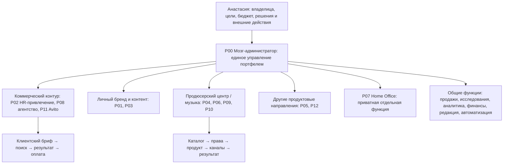

# 1. Карта иерархии и полномочий

## Согласованная иерархия

P00 — **управляющая функция**, а не самостоятельная коммерческая услуга. Два титульных зонтичных проекта — **«Личный бренд Анастасии Карташовой»** и **«Продюсерский центр Анастасии Карташовой»** — применяются как уровни группировки; существующие P-ID **не меняются**, пока не согласована новая нумерация. P07 не распространяет семейные данные в рабочие проекты.

## Матрица полномочий

| Операция | Готовит | Проверяет | Окончательно утверждает |
|---|---|---|---|
| Создать/обновить паспорт проекта | Секретарь портфеля | Мозг-администратор | Владелица для целей, бюджета и смены направления |
| Клиентский приоритет и обязательства | P08 / координатор | Мозг-администратор | Владелица |
| Исследование спроса и конкурентов | Маркетолог-исследователь | Критик + аналитик | Владелица утверждает тест |
| Текст предложения, пост, объявление | Продажник / редактор | Мозг-администратор | Владелица перед публикацией/отправкой |
| Цена, договор, расход, доступы | Исполнитель готовит материалы | Финансовая/правовая проверка | Только владелица |
| Поиск/оценка кандидатов | P08 | Рекрутер / функциональный руководитель по запросу | Решение заказчика; условия услуги — владелица |
| Каталог песен, версии, права | Продюсер / юрист | Координатор студии | Владелица перед коммерческой передачей |
| Ключи, хостинг, интеграции | Техническая роль | Безопасность и аудит | Владелица по отдельному решению |

## Обязательный паспорт результата

`project_id | task_id | результат/критерий приёмки | ответственный | срок (подтверждённый/нет) | источник | следующий шаг | зависимость | статус | фактическая оплата/затраты (если есть)`.

Задача считается закрытой, только если приложено доказательство результата; отметка ассистента, коммит или тест не подтверждают коммерческую операцию. Чужой GPT-чат автоматически не получает решения без подтверждённого канала передачи.
