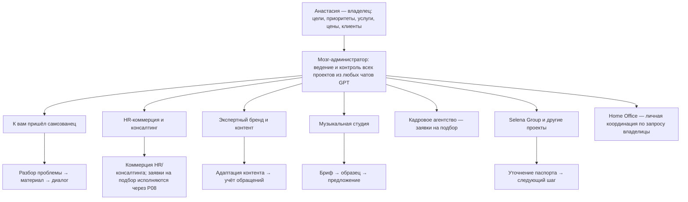

# Структура и выводы

## Иерархия

Мозг-администратор — верхний уровень управления всеми проектами Анастасии, включая проекты, создаваемые в других чатах GPT. Кадровое агентство P08 — отдельный блок исполнения всех вакансий и заявок на подбор; коммерческое привлечение заказчиков ведётся отдельно в P02. Home Office — отдельная обслуживающая функция для домашних/семейных задач; он координирует, не принимает решений и сообщает проектам только разрешённые ограничения доступности. Каждому новому проекту нужен паспорт, цель, следующий результат и привязанные решения; доступ к истории других чатов сам по себе не возникает и потребует передачи данных или подходящей интеграции. Функциональные роли и маршрут постановки задач закреплены в [операционной модели](operating-model.md), а состав функций — в [реестре ролей](roles.csv). Общие решения распространяются только на перечисленные в журнале проекты. Сценарии — процедуры работы, а не запущенные автономные агенты.

## Цели и текущие решения владельца

**Главная цель мозга-администратора:** вести и контролировать все проекты владелицы, какими бы они ни были и в каком бы GPT-чате ни возникли. Это управленческая функция над проектным портфелем.

**Коммерческий приоритет 1:** расширять охват целевой аудитории и привлекать сторонние топовые компании, которые будут направлять запросы на подбор кандидатов. Avito и HeadHunter названы владелицей как используемые направления привлечения. Это фиксирует каналы по сообщению владелицы, но ещё не доказывает число обращений, конверсию, оплату или качество лидов.

**Коммерческий приоритет 2:** консалтинг по кадровому администрированию и помощь компаниям в структурировании задач масштабирования, связывая работу с финансовыми целями компании. Формат, сегмент покупателей, доказуемые результаты и цена требуют разработки.

**Неопределённая линия:** креатив — песни, гимны и другие истории. Спрос, целевая аудитория, права и коммерческая модель пока неизвестны.

Цели личного дохода после налогов 200 000 → 300 000 → 500 000 ₽ в месяц остаются долгосрочными ориентирами владелицы; они не являются прогнозом текущей воронки. На привлечение, маркетинг и развитие бренда выделяется 3–4 часа в день; общий недельный лимит работы не установлен. Основная территория исследования — Московская область, Москва рассматривается отдельно.

Направления подбора и HR, организационных рисков, контента и AI-музыки основаны на самоописании владелицы. Конкретные подтверждения результатов, финансовые истории и рыночные данные ещё нужно собрать. Опыт специалиста по корпоративной безопасности — отдельная партнёрская компетенция.

Утренняя сводка по этапам, срокам и рынку описана в [регламенте сводки](daily-brief.md); сквозной анализ навыков ведёт [советник по монетизации](monetization.md); доступность мессенджеров и источников приведена в [матрице данных](data-access.md).

## Каких реальных оснований сейчас не хватает

Система принятия решений должна опираться на согласованные владельцем бизнес-результаты и цели, историю сделок и финансовые результаты, наблюдаемую воронку, внешнюю аналитику и фактические затраты времени. Пока эти данные не собраны, формула приоритета ниже — лишь предложенная структура учёта, а вычисленный балл не должен выглядеть как объективный бизнес-вывод.

- **Цели и результаты:** целевые показатели по подбору и консалтингу; какой именно результат считать успехом, на какой срок и для кого.
- **Финансовые истории:** прошлые заказы и проекты, суммы и сроки оплаты, расходы, налоги, повторные заказы, причины выигрыша/проигрыша. Нужны реальные данные или обезличенные истории, а не вымышленные примеры.
- **Воронка продаж:** источники обращений (включая Avito и HeadHunter), компании, вакансии/запросы, встречи, предложения, результаты и причины отказа.
- **Внешняя аналитика:** актуальные источники по компаниям, спросу на подбор и консалтинг, языку заказчиков, конкурентам и территории. Указывать источник, дату, регион, метод и ограничения.
- **Экономика и возможности:** средний чек, маржа/чистый доход, длительность цикла сделки, доступность исполнения и критерии подходящего заказчика.
- **Память о портфеле:** паспорта и решения из других чатов GPT. Сейчас материалы таких чатов недоступны; единая система сможет их контролировать, когда решения и новые проекты будут заноситься сюда вручную либо через настроенный коннектор.

Таблицы в репозитории уже созданы как каркас, а [локальная панель](dashboard.html) показывает карту системы, паспорта, стадии, задачи и пробелы. В панели добавлены месячный календарь, выделение просроченных задач и роли, нужные для работы системы. Музыкальное направление вынесено в отдельную рабочую структуру с тремя ролями. Точное имя исходного GPT-проекта и его содержание ещё предстоит перенести; даты песенных проектов не вводятся без подтверждения. Отметки задач, заметки, даты и изменения стадии сохраняются только в браузере, где открыт HTML-файл; они не обновляют CSV и не синхронизируются с другими устройствами или чатами. Это демонстрационная рабочая поверхность, а не подключённая живая система. Источники, история продаж и показатели пока пусты: наличие формы учёта не означает, что аналитика уже ведётся.

Для следующего этапа нужно выбрать единое постоянное хранилище и способ обновления из разных чатов. До выбора можно использовать Git-репозиторий как переносимую базу: вносить фактические изменения в CSV/паспорта и фиксировать решения. Автоматизация, коннекторы и плагины выбираются после того, как определены конкретные данные и повторяющаяся ручная работа, которую они заменят.

## Ресурсы и ограничения на 23.10.2026

| Ресурс | Проверено | Следующее действие |
|---|---|---|
| Репозиторий symmetrical-guide | До подготовки пустой, локальная ветка work без коммитов; удалённые ссылки Git не возвращены, запрос завершился успешно | Использовать как локальную базу; наличие удалённой main не подтверждено |
| Другие проектные файлы | При обходе /workspace доступных материалов не найдено | Подключать материалы по мере появления, сохранять прежние решения |
| Другие чаты, Selena Group | Инструмента чтения истории чатов нет | Не утверждать, что история изучена |
| Локальные инструменты | Git, Python, файлы Markdown/CSV доступны | Этого достаточно для версии 0.1 |
| Мессенджеры и почта | В этом сеансе нет инструментов чтения Telegram, MAX, почты или других чатов; Outlook Email, Slack, Teams перечислены только как необязательные плагины каталога и не подключены | См. матрицу источников; выбрать один источник по фактическому потоку клиентских обращений |
| Утренняя аналитика | Добавлены формат и экран сводки по сохранённым срокам/задачам; фонового запуска нет | Для автоматической сводки нужны интеграции и планировщик |
| Монетизация компетенций | Создан советник с перечнем заявленных навыков и правилами оценки | Нужны реальные подтверждения результатов, история продаж и рыночные сигналы |
| Цели и бизнес-результаты | Цели по привлечению компаний и консалтингу теперь зафиксированы; измеримые показатели не согласованы | Определить результаты и периоды измерения отдельно для двух приоритетов |
| Финансовые истории | Не собраны данные о прошлых сделках, расходах, оплатах и доходности | Внести реальные истории, при необходимости обезличить |
| Avito и HeadHunter | Владелица назвала их используемыми направлениями; аналитика результатов не предоставлена | Собрать активность по каждому источнику: показы/отклики при наличии, целевые компании, запросы, встречи, предложения, оплаты |
| Рыночные данные | Нет выгрузок Вордстата, проверенных клиентских запросов, источников рынка | Начать ручной сбор с датой, географией, ссылкой и ограничениями |
| Продажи | Нет списка подтверждённых лидов, согласованных цен и примеров предложений | Подготовить критерии заявки, доказательства опыта и черновик предложения |
| Партнёр по безопасности | По словам владельца: 16 лет опыта, член семьи | До упаковки выяснить работы, результаты, ответственность и границы |
| Инструкции | Создана версия 0.1 | Уточнять по обратной связи, не называть это переобучением модели |

## Что требует каких средств

Инструкции и таблицы позволяют вручную разбирать задачи, хранить решения, готовить контент и предложения. Коннектор понадобится для разрешённого чтения конкретного внешнего сервиса. Автоматизация — для расписания, переноса заявок и уведомлений. Программная разработка — для собственного приложения, авторизации, устойчивого хранения, интеграций и контроля ошибок. Версия 0.3 не требует платного API.

Вордстат можно сначала использовать вручную: выгрузка по Московской области, отдельно по Москве; записывать период, запрос, регион и тип соответствия. Частотность показывает интерес, но не готовность платить. API обсуждается только при необходимости регулярного повторения этой процедуры.

## Принятие решений и приоритизация

Решение начинается с цели проекта и ожидаемого бизнес-результата. До оценки задачи указываются: метрика результата, исходное значение (если известно), целевое значение, срок, финансовая связь, источник данных и уверенность в данных. Неизвестные значения так и помечаются; их нельзя подменять догадками. Финансовую историю сопоставлять с новой возможностью только при сходных услуге, покупателе и условиях. Внешние данные снабжать источником, датой, географией и ограничениями.

Коммерческие цели портфеля остаются: (1) привлекать компании, передающие заявки на подбор; (2) развивать консалтинг по кадровому администрированию и структурированию масштабирования. По отдельному поручению владелицы текущий приоритет продуктовой мастерской — P12, блок по безопасности предприятия и консультациям в партнёрстве. Это задаёт ближайший исследовательско-продуктовый фокус, не заменяя две коммерческие цели. Проект P12 связан с P01 «К вам пришёл самозванец»; компетенция и 16-летний опыт относятся к партнёру по сообщению владелицы и требуют уточнения, а не приписываются Анастасии. Instagram — рассматриваемая гипотеза канала. Управление всем портфелем — постоянная функция системы. Владелица может изменить приоритеты в любой момент.

Сначала обязательный срок и обещание клиенту, если они появятся. Затем оценить задачу по шкале 0–3: близость к оплате (P), подтверждение потребности (D), обоснованный вклад в доход (R), срочность (U). Неизвестное получает 0 и пометку «проверить». Для R: 0 — нет связи с продажей, 1 — косвенная связь, 2 — конкретное предложение, 3 — обсуждённый оплачиваемый объём. Это не оценка суммы дохода.

Предлагаемый временный балл для сравнения задач внутри одного приоритета: (3P + 3D + 2R + U) / затраты в часах, минимум знаменателя 0,5. Не использовать этот балл для выбора между направлениями, пока не введены цели и фактическая экономика. Шкала: 0 — нет свидетельств, 1 — слабый сигнал, 2 — конкретное подтверждение, 3 — согласованный следующий этап; для U: 0 — срока нет, 1 — в течение месяца, 2 — недели, 3 — 48 часов. Балл — средство сравнения, окончательное решение за Анастасией. Риски конфиденциальности и нехватка компетенции — отдельный фильтр, не компенсируются высоким баллом.

Пример: проверка входящего запроса с бюджетом обычно выше общей публикации; публикация по подтверждённому вопросу клиента выше оформления нового канала без аудитории. Пока фактические данные не внесены, считать приоритетами только прямые установки владелицы. Следующие действия — построить и заполнить учёт, уточнить критерии целевой компании и собирать факты по каналам. Не выдавать отсутствие записей в новой таблице за доказательство отсутствия лидов в реальности.
